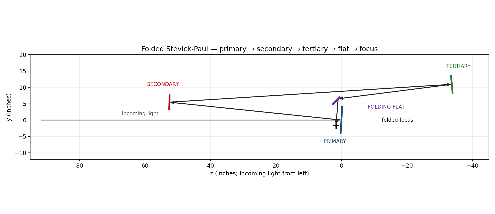
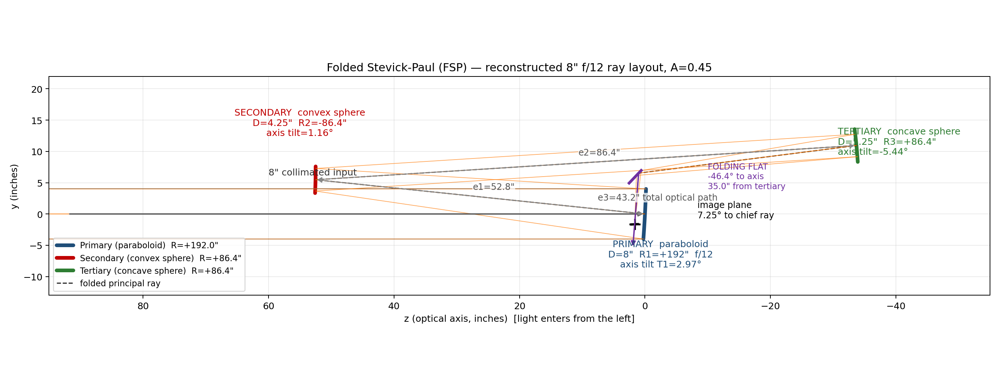

# The Folded Stevick-Paul (FSP)

How to build the **folded variant** of the Stevick-Paul telescope, with CAD drawings.
For the background geometry and equations see [`DESIGN.md`](DESIGN.md); for the
unfolded instrument and its exact raytrace see [`TRACE.md`](TRACE.md).

## 1. What it is

The FSP is the **same 3-mirror Paul core** — a paraboloidal primary plus two *mating
spheres* (a convex secondary and a concave tertiary) — with a **single flat mirror** in
the converging beam that turns the final leg back toward the primary side and extracts
the focus there. It has four mirrors, exactly like the standard SP; the flat places the
folded focus beside the primary in Novack's compact-box arrangement.

Two things distinguish it from the standard SP:

| | Standard SP | Folded SP (FSP) |
|---|---|---|
| Radius ratio `A` | 0.40 (optimum) | 0.45 (Novack) |
| Focal-plane tilt | ~4·T3 | **slightly smaller** (higher A) |
| Output | diagonal extracts focus across the sec–tert beam | last leg folds back; focus beside primary |
| Look | long tube / Schiefspiegler-like | compact box |

The higher radius ratio `A = 0.45` lengthens the instrument a little and enlarges the
spheres, but it *reduces the focal-plane tilt* — the one remaining aberration — which is
why Novack chose it.



## 2. CAD drawings

Meridional layout, dimensioned (also in `.svg` and `.dxf` for CAD import):



Files:
* `fsp_layout.png` / `fsp_layout.svg` / `fsp_layout.dxf` — meridional optical layout
* `fsp_folded.png` — schematic of the folded package

## 3. Prescription — 8" f/12, A = 0.45

This is an 8" f/12 reconstruction based on the standard Stevick-Paul equations and
Novack's published 6" f/10 layout, not Novack's original prescription. The layout
includes the reflected path after the folding flat; the folded focus is not the
conventional, unreflected tertiary focus. Coordinates: `z` = optical axis (light enters
in −z), `y` = meridional/"walk" direction; all axes in the y–z plane.

| Surface | Diameter | Vertex (y, z) | Radius | Conic | Axis tilt | Spacing |
|---------|----------|---------------|--------|-------|-----------|---------|
| Primary — paraboloid | 8.0" | (0.000, 0.000) | +192.00" | −1 | +2.973° | e1 = 52.8" |
| Secondary — convex sphere | 4.25" (min 3.94") | (5.469, 52.516) | +86.40"* | 0 | +1.156° | e2 = 86.4" |
| Tertiary — concave sphere | 5.25" (min 5.18") | (10.944, −33.710) | +86.40"* | 0 | −5.442° | e3 = 43.2" optical path |
| Folding flat | 2.0" minor | (5.947, 1.562) center | ∞ | — | 46.40° to axis | chief ray hits plane 35.0" from tertiary |
| Folded focal plane | design field 1" | (−1.649, 1.647) | — | — | 7.25° to chief ray | 8.2" after flat |

\* axis points toward the centre of curvature; the secondary is convex, the tertiary
concave as seen from the incoming beam.

Derived: F1 = 96", F2 = −43.2", F3 = 43.2"; `T1 = 2.973°`, `T2 = 4.789°`, `T3 = 1.817°`;
principal-ray angles **2·T1 = 5.945°**, **2·T3 = 3.633°**, and **−7.25°** out of the
tertiary (nominal image-plane tilt `≈ 4·T3 = 7.27°`); offsets a1 = 5.47",
a2 = 10.94"; central beam `A·D = 3.6"`. The flat reflects the tertiary's converging
cone and its image plane: the chief ray runs 35.0" from the tertiary to the flat, then
8.2" from the flat to the folded focus, preserving e3 = 43.2" total optical path. The
reflected focus lands beside the primary rather than at the conventional internal focus.
The model's on-axis geometric spot RMS is 1.80 µm at the nominal image plane (Airy
radius 8.05 µm at 550 nm); the plane flat preserves that spot under reflection.

## 4. Reference: Novack's 6" f/10, A = 0.45

Bob Novack built the first FSP at 6" f/10. His drawing gives the correcting spheres a
27.2" focal length; applying the design equations gives e1 = 33" and e3 = 27":

| Surface | Diameter | Radius | Conic | Axis tilt | Spacing |
|---------|----------|--------|-------|-----------|---------|
| Primary — paraboloid | 6.0" | +120.00" | −1 | +3.624° | e1 = 33.0" |
| Secondary — convex sphere | 3.12" | +54.00" | 0 | +1.409° | e2 = 54.0" |
| Tertiary — concave sphere | 4.25" | +54.00" | 0 | −6.640° | e3 = 27.0" |
| Folding flat | 4.0" | ∞ | — | fold | — |

(`T1 = 3.624°`, `T2 = 5.839°`, `T3 = 2.215°`; th3 = −8.85°.)

## 5. Construction sequence

1. **Make the paraboloidal primary** first, to the same f-ratio as the finished
   telescope (its f-ratio is preserved). At **f/15 the primary may be left spherical**
   — Novack's recommended simplification for the FSP.
2. **Make the two mating spheres together.** Grind the concave (tertiary) and convex
   (secondary) so they share the same radius `R = A·R1` (86.4" for the 8" f/12). Finish
   the **concave tertiary first** — it is testable like any Newtonian mirror — and use it
   as the **test plate** for the convex secondary (contact/interference test).
3. **Measure the actual radii**, then recompute `e1`, `e2`, `e3` and the tilts from the
   real numbers before making anything else.
4. **Draw the layout full-scale** (this is mandatory). Lay in the mirror centers from the
   spacings and axis distances, bisect the principal-ray angles, and draw the mirror
   surfaces perpendicular to the bisectors. Locate the **folding flat** and the focus —
   see §6.
5. **Make the flat.** A good flat can be made by the Ritchey-Common test against the
   spherical primary (the method Novack used).
6. **Build the structure** with tip/tilt on all mirrors and longitudinal adjustment on
   the primary–secondary spacing (the only spacing that matters much). Blacken all mirror
   edges and chamfer/blacken the flat's hip so it doubles as a baffle.
7. **Coat and collimate** — see [`BUILD_NOTES.md`](BUILD_NOTES.md); alignment is
   geometric (no star-test procedure).

## 6. Placing the folding flat (the critical step)

The flat sits in the converging tertiary→focus cone and must **not** cross the
collimated secondary→tertiary beam, which runs within a fraction of an inch of it. For
the reconstructed 8" f/12 FSP model, the placement is:

* the chief ray intersects the flat at **35.0" from the tertiary** (y ≈ 6.53", z ≈ 1.01");
* flat surface at **≈ 46.4° to the optical axis**,
* required upper-edge clearance is **0.60"** from the chief-ray hit; a 2"-minor flat
  (about 2.8" along its surface) extends downward from that edge, keeping the **upper
  edge tangent to the collimated beam**.
* reflected principal ray exits at **−85.54° to +z**, reaching the folded focus at
  (y, z) ≈ **(−1.65", 1.65")**, beside the primary. Its focal plane is the reflection of the original image
  plane; the un-folded focus is only a construction reference, not the final image location.

The generator verifies 100% capture and zero obstruction for 1,793 sampled on-axis pupil
rays with the 2"-minor flat, including the incoming, primary–secondary, and
secondary–tertiary segments, plus clearance from all three powered mirrors after the fold.
This is a sampled geometric check, not a substitute for re-deriving the flat position and
clearance for the as-built full-scale layout.

## 7. Notes and trade-offs

* **A = 0.45** is what makes the folded version worthwhile — slightly less focal-plane
  tilt than A = 0.40.
* **Focal plane is still tilted** (~7.3° at f/12) and gently curved; tilt the
  eyepiece/sensor to match. Not a wide-field imaging telescope.
* **At f/15 the primary can be spherical**, which removes the only parabolizing step.
* **Four reflections** → use enhanced coatings (~0.85 transmission).
* The fold makes the tube a **compact box**; the focus exits near the aperture side, a
  convenient, nearly stationary eyepiece position.

## 8. Reproduce

```bash
python3 fsp_outputs.py        # writes fsp_layout.{png,svg,dxf} and fsp_folded.png
```

Uses the raytracer in [`sp_model.py`](sp_model.py).

## 9. References

* R. Novack, "A New Telescope Design: Folded Stevick-Paul Four-Mirror F10 Reflecting
  Telescope," AmSky/SEDS archive:
  <https://web.archive.org/web/20050309051430/http://www.amsky.com/atm/telescopes/spscopes/spt.html>
* D. Stevick, "The Stevick-Paul Off-Axis Reflecting Telescope," *ATMJ* Issue 3, pp. 4–9
  (1993).
