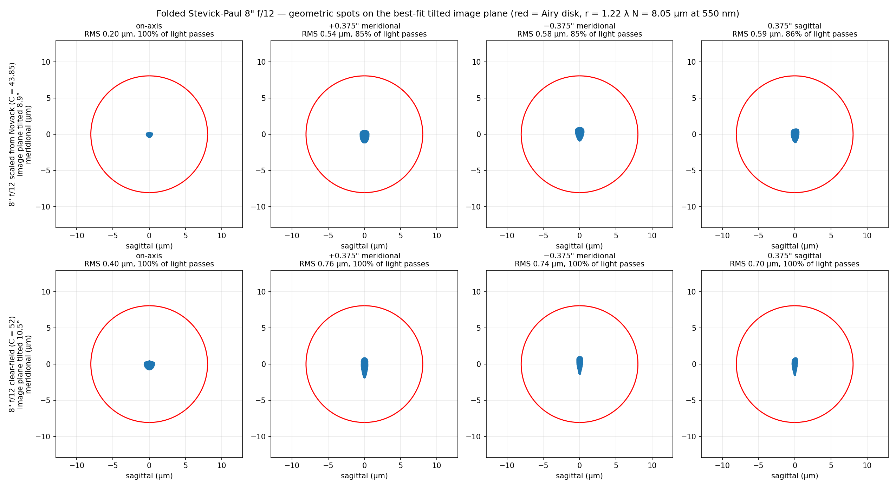
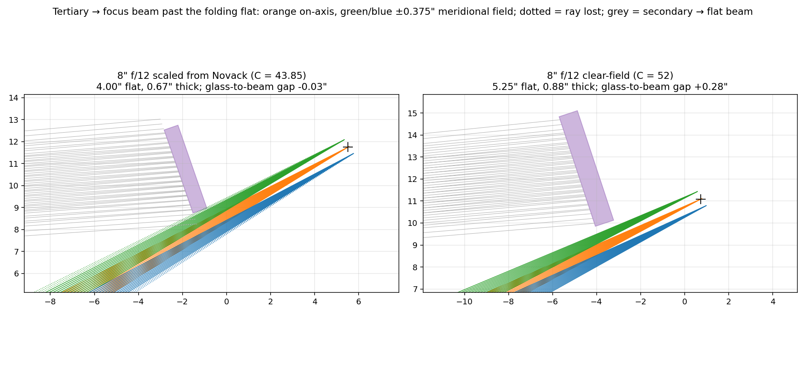
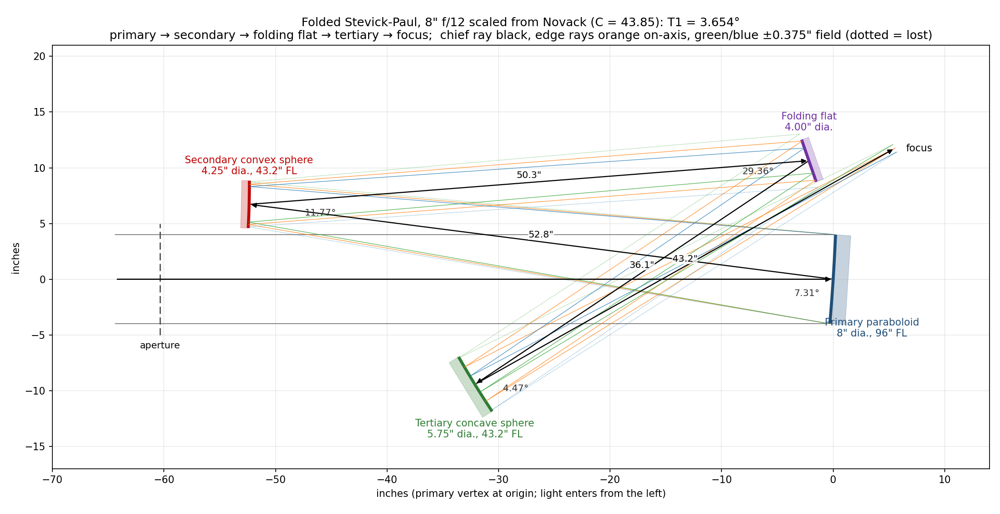
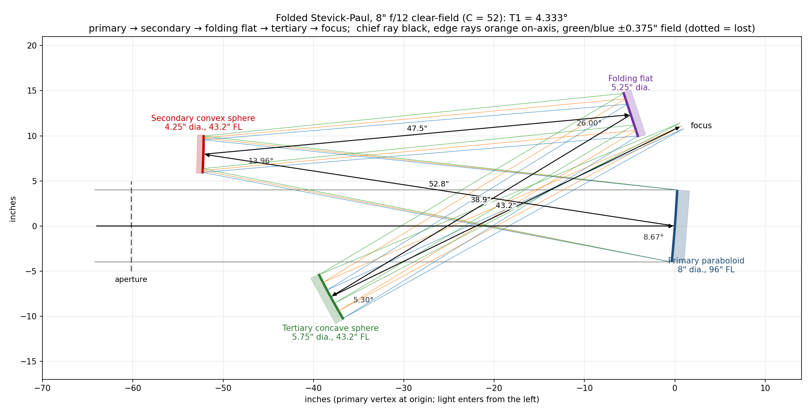

# The Folded Stevick-Paul (FSP)

How to build the **folded variant** of the Stevick-Paul telescope, with CAD drawings.
For the background geometry and equations see [`DESIGN.md`](DESIGN.md); for the
unfolded instrument and its exact raytrace see [`TRACE.md`](TRACE.md).

## 1. What it is

The FSP is the **same 3-mirror Paul core** — a paraboloidal primary plus two *mating
spheres* (a convex secondary and a concave tertiary) — with a **flat folding mirror
placed in the collimated beam between the secondary and the tertiary**. The order is:

**primary → secondary → folding flat → tertiary → focus**

The flat throws the secondary's collimated beam back across the tube to a tertiary that
sits *below* the incoming beam; the tertiary then sends its converging cone up past the
edge of the flat to a focus just behind and above the primary. The flat replaces the
standard SP's diagonal, so it is still four mirrors. This order is fixed by Novack's
drawing (legs labelled 32.8" primary–secondary, 31.7" secondary–flat, 22.7" flat–tertiary,
27.2" tertiary–focus) and by his text: a baffle sits "in the triangular area between the
secondary and the flat and runs parallel to the beam between the secondary and the flat".

| | Standard SP | Folded SP (FSP) |
|---|---|---|
| Radius ratio `A` | 0.40 (optimum) | 0.45 (Novack: 27.2/60 = 0.453) |
| Primary tilt `T1` | `C/N`, C ≈ 35.7 | larger (Novack: 2·T1 = 8.77° at f/10) |
| Flat | diagonal in the tertiary's converging cone | fold flat in the collimated secondary→tertiary beam |
| Focus | beside the long tube | just behind/above the primary |
| Look | long tube / Schiefspiegler-like | compact box ~0.6 F1 long |

The C table in [`DESIGN.md`](DESIGN.md) is for A = 0.4 and a straight layout; the fold
needs a larger primary tilt so the tertiary can sit clear of the incoming beam and the
returning cone can clear the flat (§3).

## 2. Novack's 6" f/10, as drawn


| Surface | Diameter | Radius | Conic | Next leg |
|---------|----------|--------|-------|----------|
| Primary — paraboloid | 6.0" | 120.0" (FL 60") | −1 | 32.8" to secondary |
| Secondary — convex sphere | 3.12" | 54.4" (FL 27.2") | 0 | 31.7" to flat |
| Folding flat | 4.0" | ∞ | — | 22.7" to tertiary |
| Tertiary — concave sphere | 4.25" | 54.4" (FL 27.2") | 0 | 27.2" to focus |

Angles between the arriving and leaving chief ray at each mirror, as labelled on his
drawing: 8.77°, 14.04°, 29.36°, 5.29°.

Stevick's equations (`T2 = (1+A)/(2A)·T1`, `T3 = T2 − T1`, tertiary turning the chief
ray by 2·T3) with the single number **T1 = 4.385°** (`C = N·T1 = 43.85`), plus the flat's
position and fold angle, reproduce **every** point on his drawing to 0.01": angles
8.77°, 14.06°, 29.36°, 5.29°; vertices (x along the tube, y up, primary at the origin)
secondary (−32.42, 5.00), flat (−0.85, 7.92), tertiary (−19.53, −4.98), focus
(4.18, 8.35). `sp_model.build_fsp()` builds it.

Raytraced, it is a real, corrected design, not a sketch: on-axis RMS spot 0.58 µm
(Airy radius 6.7 µm at f/10) with best focus at exactly his 27.2".

**But the drawn flat does not fit as drawn.** Modelled as a real piece of glass — a 4"
disc, 0.67" thick (1/6 of its diameter), centred on the chief ray — its lower back corner
sits in the returning tertiary→focus cone and would pass only **55%** of the light
on-axis. The on-axis footprint on the flat is only 2.8" across, so a **3" flat** clears
on-axis by 0.32" and passes 100% on-axis, 94% at 0.15" off-axis, and ~83% at 0.3" (the
field Novack's mirror sizes imply). Novack's "I have chamfered off its hip" is exactly
this problem; his flat was evidently cut back, offset, or both.

## 3. The flat-clearance problem

### Why the flat and the returning cone collide

In this topology the tertiary→focus cone must pass the flat's lower edge to reach a
focus behind the primary. At the flat, the returning chief ray is offset from the
flat's centre by roughly

    (flat→tertiary distance) × sin(2·T3)

— 2.8" for an 8" f/12 scaled from Novack — and that has to accommodate half the flat,
the flat's thickness seen obliquely, half the (narrow) returning cone, and the field. A
flat big enough to cover the field is also big enough to reach into the returning cone.
The field drives the flat size quickly: the flat is far from the image of the stop, so
the secondary→flat footprint walks across it with field angle (for the 8", 3.7" on-axis
but 5.0" for a 0.75" field).

An earlier version of this page claimed 0.53" clearance and "no chamfer needed"; that
check treated the flat as a zero-thickness disc and traced only on-axis rays. All checks
now model every mirror as a **solid disc, thickness = diameter/6**, and trace the on-axis
beam plus field points at ±0.375" (meridional) and 0.375" (sagittal) — a 0.75" field,
0.45° at f/12. A ray counts as lost if it misses a mirror or passes through any other
mirror's glass.

### What does and does not fix it

For an 8" f/12 at A = 0.45, searching flat position (45–70% of the way from secondary to
tertiary) and fold angle (20–44°), with every mirror sized to the 0.75" field and the
focus kept behind the primary:

| Primary tilt | best flat-glass to beam gap |
|---|---|
| C = 43.85 (T1 = 3.65°, Novack's C scaled by 1/N) | −0.53" (no placement clears) |
| C = 48 (T1 = 4.00°) | +0.05" |
| C = 52 (T1 = 4.33°) | +0.32" |
| C = 56 (T1 = 4.67°) | +0.58" |
| C = 60 (T1 = 5.00°) | +0.86" |

* **Moving the flat alone does not work.** Placements that clear exist, but they put
  the focus *inside* the tube, a couple of inches above the incoming beam; the eyepiece
  would then stick up through the secondary→flat beam.
* **Chamfering or thinning the flat** gains only ~0.07".
* **A larger primary tilt does work.** The tertiary's turn (2·T3) grows with T1 and
  opens the gap. The price is a steeper focal plane (≈ 4·T3) and slightly larger spots,
  both modest.

Note that C = 52 at f/12 gives T1 = 4.33°, almost exactly Novack's own 4.385°. Scaling
his tilt down by 1/N (as for the A = 0.4 C table) is what loses the clearance; keeping
his *angles* keeps it.

## 4. Two 8" f/12 layouts

Both use A = 0.45 (R1 = 192", R2 = R3 = 86.4"; F1 = 96", F2 = −43.2", F3 = 43.2";
e1 = 52.8", e2 = 86.4", e3 = 43.2") and differ in the primary tilt and the flat's
placement. Neither is a prescription Novack published. Coordinates are as drawn: x along
the tube with light travelling +x, primary vertex at the origin, y up; directions are
measured from +x. Mirror diameters cover the 0.75" field (DESIGN.md eqns 1–2 plus a
0.1" margin), except the flat in layout A.

| | **A — scaled from Novack** | **B — clear-field (recommended)** |
|---|---|---|
| C, T1 / T2 / T3 | 43.85; 3.654° / 5.887° / 2.233° | 52; 4.333° / 6.981° / 2.648° |
| Angles at P / S / flat / T | 7.31° / 11.77° / 29.36° / 4.47° | 8.67° / 13.96° / 26.00° / 5.30° |
| Flat position | 58.3% of e2 from the secondary (Novack's) | 55% |
| Folding flat | **4.0"** (limited by the returning cone) | 5.25" |
| Flat glass to returning beam | −0.03" at the field edge | **+0.28"** |
| Light passed: on-axis / 0.375" field | 100% / 85–86% | 100% / 100% |
| RMS spot: on-axis / 0.375" field | 0.20 / 0.54–0.59 µm | 0.40 / 0.70–0.76 µm |
| Image-plane tilt (raytraced; 4·T3) | 8.89° (8.93°) | 10.51° (10.59°) |

The spots are computed on the best-fit tilted image plane through the best foci of the
five field points; the fitted tilt confirms Stevick's eqn 6 (`≈ 4·T3`) to 0.1°. Both
layouts are far inside the Airy disk (radius 8.05 µm at 550 nm) over the whole field.
The difference is light, not sharpness: layout A loses ~15% at the field edge (~8% at
0.25") — mostly rays that miss the undersized flat — and its flat glass grazes the
returning beam, so it must be chamfered and placed accurately; layout B passes
everything with a quarter-inch to spare.





### Layout A — scaled from Novack (C = 43.85)



| Surface | Diameter | Vertex (x, y) | Radius | Conic | Surface normal | Next leg |
|---------|----------|---------------|--------|-------|----------------|----------|
| Primary — paraboloid | 8.0" | (0.00, 0.00) | 192.0" | −1 | 176.35° (3.65° tilt) | 52.80" to secondary |
| Secondary — convex sphere | 4.25" | (−52.37, 6.72) | 86.4" | 0 | 178.58° (1.42° tilt) | 50.35" to flat |
| Folding flat | 4.0" | (−2.18, 10.64) | ∞ | — | −160.85° (19.15° from square to the tube) | 36.05" to tertiary |
| Tertiary — concave sphere | 5.75" | (−32.13, −9.43) | 86.4" | 0 | 31.59° | 43.20" to focus |
| Focus | — | (5.52, 11.75) | — | — | image plane tilted 8.9° | — |

Smallest glass-to-beam gaps: primary 4.11", secondary 0.39", flat −0.03", tertiary 3.31".
Of the flat sizes tried (3.75–5.25"), 4.0" loses least at the field edge: a larger flat
reaches into the returning cone (5.0" already blocks 8% on-axis), a smaller one misses
more of the incoming field.

### Layout B — clear-field (C = 52)



| Surface | Diameter | Vertex (x, y) | Radius | Conic | Surface normal | Next leg |
|---------|----------|---------------|--------|-------|----------------|----------|
| Primary — paraboloid | 8.0" | (0.00, 0.00) | 192.0" | −1 | 175.67° (4.33° tilt) | 52.80" to secondary |
| Secondary — convex sphere | 4.25" | (−52.20, 7.96) | 86.4" | 0 | 178.31° (1.69° tilt) | 47.52" to flat |
| Folding flat | 5.25" | (−4.88, 12.34) | ∞ | — | −161.70° (18.30° from square to the tube) | 38.88" to tertiary |
| Tertiary — concave sphere | 5.75" | (−38.10, −7.85) | 86.4" | 0 | 28.65° | 43.20" to focus |
| Focus | — | (0.73, 11.08) | — | — | image plane tilted 10.5° | — |

Smallest glass-to-beam gaps: primary 6.70", secondary 1.63", flat 0.28", tertiary 1.39".

Files (each layout also as `.svg` and `.dxf`, with mirror blanks drawn to thickness):
* `fsp8_scaled.{png,svg,dxf}` — layout A
* `fsp8_clear.{png,svg,dxf}` — layout B
* `fsp8_spots.png` — spot diagrams with the Airy disk, both layouts
* `fsp8_flat_zoom.png` — close-up of the flat and the returning cone, both layouts
* `fsp_folded.png` — Novack's 6" f/10, regenerated (compare with his `fspdiagm.gif`)

## 5. Construction sequence

1. **Make the paraboloidal primary** first, to the same f-ratio as the finished
   telescope (its f-ratio is preserved). At **f/15 the primary may be left spherical**
   — Novack's recommended simplification for the FSP.
2. **Make the two mating spheres together.** Grind the concave (tertiary) and convex
   (secondary) so they share the same radius `R = A·R1` (86.4" for the 8" f/12). Finish
   the **concave tertiary first** — it is testable like any Newtonian mirror — and use it
   as the **test plate** for the convex secondary (contact/interference test).
3. **Measure the actual radii**, then recompute `e1`, `e2`, `e3` and the tilts from the
   real numbers before making anything else.
4. **Draw the layout full-scale** (this is mandatory). Lay in the mirror centers from the
   spacings and axis distances, bisect the principal-ray angles, and draw the mirror
   surfaces perpendicular to the bisectors. Draw the **flat as a real blank, with its
   thickness**, and the returning cone for the edge of the field — see §6.
5. **Make the flat.** A good flat can be made by the Ritchey-Common test against the
   spherical primary (the method Novack used).
6. **Build the structure** with tip/tilt on all mirrors and longitudinal adjustment on
   the primary–secondary spacing (the only spacing that matters much). Blacken all mirror
   edges and chamfer/blacken the flat's hip so it doubles as a baffle.
7. **Coat and collimate** — see [`BUILD_NOTES.md`](BUILD_NOTES.md); alignment is
   geometric (no star-test procedure).

## 6. Placing the folding flat (the critical step)

The flat sits in the **collimated** beam from the secondary, so its position along that
beam does not affect focus — only where the tertiary and the focus end up. Then:

* the tertiary lands below the incoming beam, on the far side of the tube from the
  secondary;
* the flat→tertiary and tertiary→focus legs cross the incoming beam in free air (beams
  crossing beams is harmless; only mirrors obstruct);
* the tertiary→focus cone passes just beside the flat's lower edge on its way to the
  focus behind the primary. **This is the tight clearance**, and it is set by the flat's
  *back* corner as much as its face: check it with the blank's real thickness and with
  the cone for the edge of the field, not just on-axis (§3, `fsp8_flat_zoom.png`).

Keep `flat→tertiary + secondary→flat = e2 = R3` exactly: that spacing is part of the
Paul correction.

## 7. Notes and trade-offs

* **Primary tilt** is the main lever on the flat clearance. Novack's own tilt (T1 ≈
  4.3–4.4°) clears an 8" f/12; scaling it down as 1/N does not.
* **Focal plane is tilted** (≈ 4·T3: 8.9° for layout A, 10.5° for layout B) and gently
  curved; tilt the eyepiece/sensor to match. The standard 8" f/12 SP is 9.0°. Not a
  wide-field imaging telescope.
* **At f/15 the primary can be spherical**, which removes the only parabolizing step.
* **Four reflections** → use enhanced coatings (~0.85 transmission).
* The fold makes the tube a **compact box** about 0.6·F1 long; the focus is at the
  closed (primary) end, above the primary.

## 8. Reproduce

```bash
python3 fsp_outputs.py
# prints both prescriptions, glass-to-beam gaps, spots and vignetting; writes
# fsp_folded.png, fsp8_{scaled,clear}.{png,svg,dxf}, fsp8_spots.png, fsp8_flat_zoom.png
```

Uses `build_fsp()` and the raytracer in [`sp_model.py`](sp_model.py). The script fails
if the clear-field layout has any mirror's glass in a beam.

## 9. References

* R. Novack, "A New Telescope Design: Folded Stevick-Paul Four-Mirror F10 Reflecting
  Telescope," AmSky/SEDS archive:
  <https://web.archive.org/web/20050309051430/http://www.amsky.com/atm/telescopes/spscopes/spt.html>
  (diagram: `fspdiagm.gif` in the same archive)
* D. Stevick, "The Stevick-Paul Off-Axis Reflecting Telescope," *ATMJ* Issue 3, pp. 4–9
  (1993).
