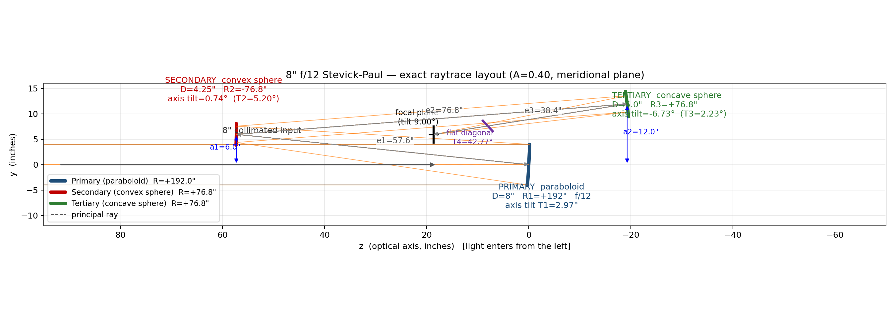
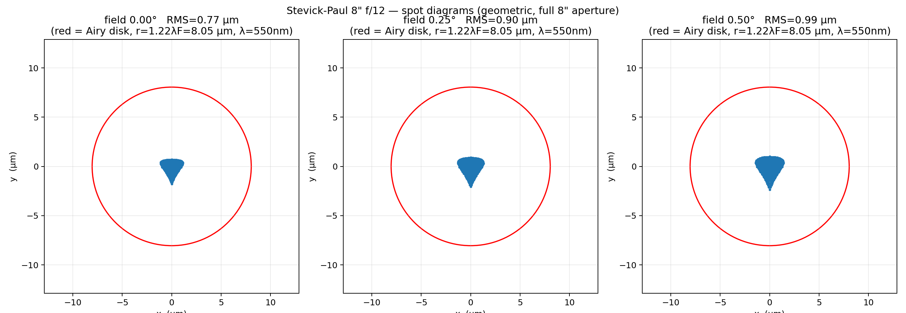
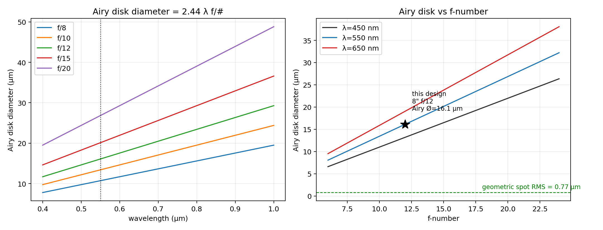

# Stevick-Paul Telescope

Design notes, a buildability assessment, and an **exact raytrace** of the Stevick-Paul
telescope (SPT) — an unobstructed, all-reflecting, tilted-component design that is free
of third-order aberrations. This repository focuses on an **8" f/12** instrument.

## The arrangement

Incoming collimated light → **paraboloidal primary** → **convex spherical secondary** →
**concave spherical tertiary** → focus, extracted by a **flat diagonal**. The two
spheres are of *mating curve* (radius = 0.4 × the primary radius of curvature). All
mirrors are used off-axis so the aperture is unobstructed.



## Exact raytrace result

The geometry was reconstructed from the archived design manual plus Bob Novack's labelled
Folded-Stevick-Paul diagram, then refined by exact raytracing. The one unknown — the
principal-ray angle out of the tertiary — solved to **9.000°**, which *is* the
focal-plane tilt. The resulting system is:

* Radii: **+192"** paraboloid, **+76.8"** convex sphere, **+76.8"** concave sphere
* Spacings: **e1 = 57.6"**, **e2 = 76.8"**, **e3 = 38.4"**; offsets a1 = 6", a2 = 12"
* Principal-ray angles: **2·T1 = 5.945°**, **2·T3 = 4.459°**, **9.000°**
* Verified **diffraction limited**: geometric spot RMS **0.77 µm** on-axis, ~1.06 µm at
  1° field, versus the **8.05 µm** Airy radius (λ = 550 nm, f/12)

Spot diagrams (tiled with the Airy disk):



Airy disk diameter versus wavelength and f-number:



## Repository contents

| File | Description |
|------|-------------|
| [`DESIGN.md`](DESIGN.md) | Collected facts, equations, history, and tradeoffs |
| [`BUILD_NOTES.md`](BUILD_NOTES.md) | Buildability assessment, f/12 vs f/15, risk register, why f/10+ only |
| [`TRACE.md`](TRACE.md) | Exact prescription, method, results, and caveats |
| `sp_layout.png` / `.svg` / `.dxf` | CAD-style meridional layout |
| `sp_spotdiagrams.png` | Spot diagrams at 0.00°, 0.25°, 0.50° field |
| `sp_airy.png` | Airy disk diameter vs wavelength and vs f-number |
| [`sp_model.py`](sp_model.py) | Reproducible conic raytracer and `build_sp()` |
| [`make_outputs.py`](make_outputs.py) | Regenerates all figures |

## Reproducing the figures

```bash
python3 -m pip install numpy scipy matplotlib
python3 make_outputs.py
```

## Sources

The original *Amateur Telescope Makers Journal* #3 article (1993) and Stevick's own
raytracer are not available; this reconstruction is based on the archived material at:

* SEDS: <https://spider.seds.org/scopes/dstevick/stevpaul.html>
* Full design manual (Wayback/AmSky):
  <https://web.archive.org/web/20050309051430/http://www.amsky.com/atm/telescopes/spscopes/spt.html>

This is an independent reconstruction, not the original prescription; it reproduces
Stevick's published values and his claimed aberration-free image.
